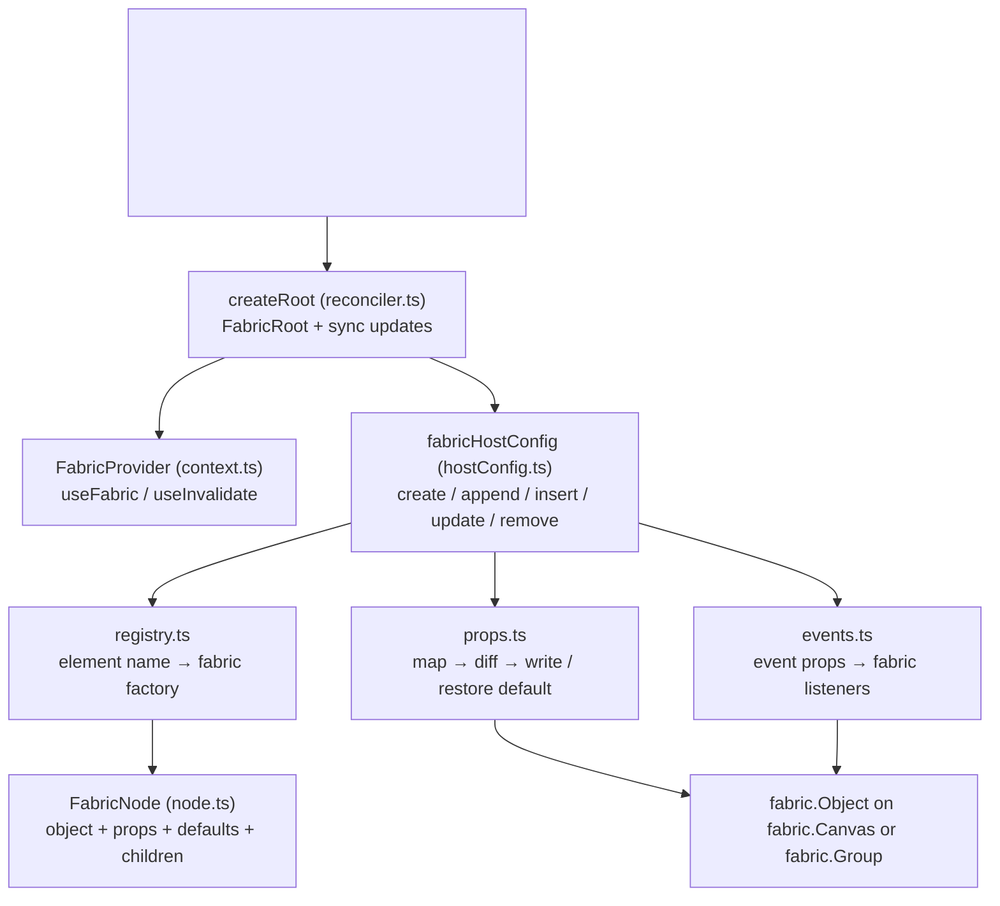

# Repository Guidelines

## Project Overview

pnpm workspace for a React 19 renderer that turns JSX into [Fabric.js](http://fabricjs.com/) v5 objects:

- `@digs/react-fabric-fiber` (`packages/react-fabric-fiber`) — custom `react-reconciler` host that creates, mutates, and destroys `fabric.Object` instances on a `fabric.Canvas`. Exposes `<Canvas>`, built-in element wrappers, `<Primitive>`, `createFabricComponent`, `applyProps`, `createRoot`, `useFabric`, `useInvalidate`.
- `@digs/draft` (`packages/draft`) — reusable scene components built on the renderer: `PDFPage`/`PDFPageObject` (pdf.js → fabric vectors), `useSelection`, `ViewportControls`.
- `apps/homepage` — private Vite/MDX documentation site with the maintained live demos.

## Architecture & Data Flow

The renderer is mutation-mode only: one `fabric.Object` per host fiber, updated in place; `resetAfterCommit` calls `canvas.requestRenderAll()` once. Commits are synchronous (`updateContainerSync`); do not introduce concurrent scheduling.



Mount path: `<Canvas>` measures its container, constructs `fabric.Canvas` (or the injected `canvasFactory`), calls `createRoot`, then renders children through `FabricProvider`. Each host element becomes a `FabricNode` whose `object` comes from `resolveFactory(type)` (PascalCased name) or, for `<Primitive>`, from the caller-owned `object` prop.

Update path: `commitUpdate` → `diffProps` (structural equality for arrays/plain objects, so inline literals don't fight user drags) → `writeProp` per changed key. The first write to a key captures the fabric default in `node.defaults`; removing a prop restores it. `node.props` must be updated after diffing because event dispatch reads handlers from it. `setCoords()` runs after every apply so hit-testing matches geometry.

### Architectural Invariants

- Only `<Group>` or `<Primitive object={fabric.Group}>` may have children; all others must throw.
- Group children use group-local coordinates. After any add/remove/insert, re-apply `position`/`scale`/`rotation` (`reapplyGroupTransform`) or the group transform is lost.
- `<Primitive>` objects are removed on unmount but never disposed; ownership stays with the caller. Changing `object` instance requires a new `key`.
- Event listeners are stored in `node.listeners`; detach before removal/primitive replacement, never double-bind.
- `ref`, `children`, `key`, `object`, `zIndex`, `crossOrigin`, `onLoad`, `onError` are reserved and must never reach `object.set`.
- `<Text>` receives content through the `text` prop; raw text children are invalid (`createTextInstance` throws).
- `zIndex` participates in canvas ordering alongside JSX order; reordering managed children must not fire add/remove events.

## Key Directories

| Path                                | Purpose                                                                                                   |
| ----------------------------------- | --------------------------------------------------------------------------------------------------------- |
| `packages/react-fabric-fiber/src/`  | Renderer source; public barrel is `index.ts`                                                              |
| `packages/react-fabric-fiber/test/` | Renderer contract suite (`fiber.test.tsx`)                                                                |
| `packages/draft/src/pdf/`           | PDF operator, path, text, image, and page translation                                                     |
| `packages/draft/test/`              | PDF, viewport, and selection suites plus `fixtures/*.pdf`                                                 |
| `apps/homepage/src/article/`        | MDX documentation pages (canonical user docs)                                                             |
| `apps/homepage/src/demos/`          | Live canvas demos embedded by those pages                                                                 |
| `test/setup.ts`                     | Global Vitest setup (`IS_REACT_ACT_ENVIRONMENT = true`)                                                   |
| Root configs                        | `vitest.config.ts`, `eslint.config.js`, `prettier.config.js`, `tsconfig.base.json`, `pnpm-workspace.yaml` |

## Development Commands

Run from the workspace root.

```sh
pnpm install          # pnpm 12.14.0, Node 22.19.0 (.tool-versions)
pnpm dev              # docs site: pnpm --filter homepage dev
pnpm test             # vitest run (all packages)
pnpm typecheck        # recursive tsc --noEmit
pnpm typecheck:root   # tsc -p tsconfig.json (root test/config files)
pnpm build            # recursive tsup + vite build
pnpm lint             # eslint .
pnpm format           # prettier --write .
pnpm check            # lint → format:check → typecheck → typecheck:root → test
```

Targeted work:

```sh
pnpm --filter @digs/react-fabric-fiber build
pnpm --filter @digs/react-fabric-fiber typecheck
pnpm exec vitest run packages/react-fabric-fiber/test/fiber.test.tsx
pnpm exec vitest run -t "reconciliation"
pnpm exec vitest            # watch
```

Tests only run from the root: no package defines a `test` script, and `vitest.config.ts` includes only `packages/*/test/**/*.test.{ts,tsx}`.

## Code Conventions & Common Patterns

- **Formatting is Prettier-owned**: no semicolons, double quotes, trailing commas, width 100. Imports are auto-sorted (builtins → `react` → `react-dom` → third-party → blank → relative); run `pnpm format` after adding imports.
- **Types**: strict TS with `noUncheckedIndexedAccess`; all function inputs/outputs typed. Use inline type imports (`import { type X }`), enforced by ESLint. `no-explicit-any` is an error.
- **No comments** in source. If behavior needs explanation, rename, restructure, or encode it in a type/invariant.
- **Naming**: `to*` coercion (throws `TypeError` naming the prop), `require*` invariant accessor, `is*` guard, `resolve*` lookup, `apply*`/`attach*`/`detach*` side effects.
- **Prop mapping** lives in `MAPPED_PROPS` in `props.ts`: `position` → `left`/`top`, `scale` → `scaleX`/`scaleY`, `rotation` → `angle`; everything else goes through `object.set`. `points`, `path`, `element`, `src`, `crossOrigin`, `onLoad`, `onError` have special handling.
- **Errors**: throw during construction/commit via `invariant` or `TypeError` with a corrective hint. There is no `try/catch` in the library; never swallow host-config or reconciler errors.
- **Async is avoided**: only fabric `setSrc`/`loadImage` callbacks and `ResizeObserver` are asynchronous. Imperative canvas work belongs in `useLayoutEffect`; latest callbacks go in refs; exposed handles use `useImperativeHandle`.
- Components are thin arrow-function wrappers; exported hooks/functions use `function` declarations.
- Public API changes must be exported from `src/index.ts` and covered in `fiber.test.tsx`.

## Important Files

| File                                             | Role                                                                             |
| ------------------------------------------------ | -------------------------------------------------------------------------------- |
| `packages/react-fabric-fiber/src/index.ts`       | Public barrel; every new export goes here                                        |
| `packages/react-fabric-fiber/src/reconciler.ts`  | Reconciler instance, `FabricRoot`, `createRoot`, sync render, canvas factory     |
| `packages/react-fabric-fiber/src/hostConfig.ts`  | Host config, node creation, tree/group mutation, primitive replacement, teardown |
| `packages/react-fabric-fiber/src/props.ts`       | Prop mapping, default capture/restore, structural diff, `applyProps`             |
| `packages/react-fabric-fiber/src/events.ts`      | Event prop table, listener binding, `FabricEvent`, click composition             |
| `packages/react-fabric-fiber/src/node.ts`        | `FabricNode` / `RootContainer` data model                                        |
| `packages/react-fabric-fiber/src/components.tsx` | Element components, `createFabricComponent`, `<Canvas>` sizing/lifecycle         |
| `packages/react-fabric-fiber/src/context.ts`     | `FabricProvider`, `useFabric`, `useInvalidate`                                   |
| `packages/react-fabric-fiber/src/types.ts`       | JSX prop and event types                                                         |
| `packages/draft/src/pdf/PDFPageObject.ts`        | pdf.js page → fabric object tree                                                 |
| `apps/homepage/src/article/getting-started.mdx`  | Canonical usage example and peer requirements                                    |
| `vitest.config.ts`                               | jsdom, include glob, source aliases                                              |

## Runtime/Tooling Preferences

- **Node 22.19.0 / pnpm 12.14.0**, pinned in `.tool-versions` and `packageManager`; pnpm is the only supported package manager.
- **ESM-first**: all packages are `type: module`; CJS consumers use `dist/index.cjs`. Both packages build with tsup (ESM + CJS + d.ts + sourcemaps), externalizing React, `react-reconciler`, `scheduler`, `fabric`, and (for draft) `@digs/react-fabric-fiber`.
- **TypeScript never emits**; `tsup` and Vite are the only emitters.
- The package names are aliased to source in four places: package `tsconfig.json` files, `vitest.config.ts`, and `apps/homepage/vite.config.ts`. Changing an entry point requires updating all aliases.
- `fabric` is pinned to v5 (`>=5.3.5 <6` in the renderer peer); React 19 is required (`>=19.1.0 <20`). `react-reconciler` is a hard dependency on the 0.32 line.
- `pnpm-workspace.yaml` approves native builds for `canvas` and `esbuild`; omitting them breaks fabric/jsdom tests and tsup/Vite.
- No CI, changesets, or release automation. Publishing is manual: `prepack` builds `dist`, `files: ["dist"]`, `publishConfig.access: "public"`.
- The homepage Vite config must keep `react`/`react-dom` in `resolve.dedupe`, or renderer hooks bind to a second React copy.

## Testing & QA

- **Vitest 5 + jsdom**, single root config. `test/setup.ts` sets `IS_REACT_ACT_ENVIRONMENT`; no globals configured, so import `describe`/`it`/`expect`/`vi` from `vitest`.
- Tests import source through aliases, so no build is required. Only `packages/*/test/**/*.test.{ts,tsx}` runs.
- `packages/react-fabric-fiber/test/fiber.test.tsx` is the executable contract: mount, in-place reconciliation, default restoration, keyed ordering, groups, events, refs/hooks, primitives, image lifecycle, canvas ownership, StrictMode.
- `packages/draft/test/` covers PDF operators/page integration, selection, and viewport interaction. `pdf-corpus.test.ts` is opt-in via `PDFJS_CORPUS=/path/to/pdfs`.
- Conventions: local `render()` helper creates a div + React root, injects the canvas ref with `cloneElement`, and wraps render/rerender/unmount in `await act(async () => …)`. Fire fabric events directly on objects, use `vi.fn()` handlers, and assert object identity and exact error text; no snapshots or Testing Library.
- Tests are typechecked (`packages/*/tsconfig.json` include `test`), so they must satisfy strict TS and `noUncheckedIndexedAccess`.
- No coverage provider or thresholds configured. QA gate is `pnpm check`; when changing renderer behavior, extend `fiber.test.tsx` at the public-API level rather than testing internals.
